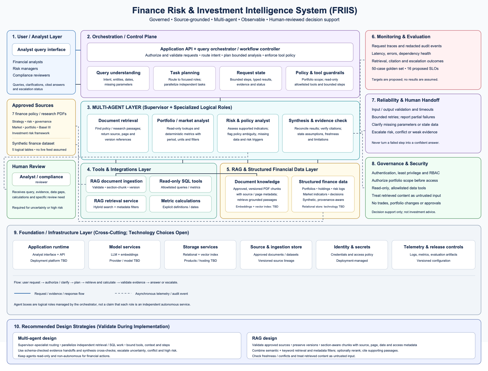

# FRIIS Project Architecture

The diagram below adapts the reference's numbered layers to the Finance Risk & Investment Intelligence System. It is based on the [Master Capstone Project Overview](../../Master%20Capstone%20Project%20Overview.md), FRIIS project brief, [Project Approach](../Sprint%201/Project_Approach_Document.docx), [Initial System Blueprint](../Sprint%201/Initial_System_Blueprint.md), finance dataset specification, evaluation plan, and supplied policy/framework documents.



Open [FRIIS_Architecture.png](./FRIIS_Architecture.png) to view or reuse the diagram.

## What the architecture represents

- **Analyst-facing decision support:** financial analysts, risk managers, and compliance reviewers ask questions and receive answers with citations, dates, assumptions, limitations, and escalation status.
- **Multi-agent layer:** a supervisor routes by intent to focused retrieval, portfolio/market, and risk/policy roles. Keep tool use bounded and read-only; parallelize independent evidence tasks; validate structured handoffs; cross-check in synthesis; escalate unresolved uncertainty or high-risk cases.
- **RAG layer:** validate and version approved documents, chunk by meaningful sections, retain source/page/date/access metadata, combine semantic and keyword retrieval with metadata filters, and ground claims in cited passages. Relevance reranking is an optional implementation strategy.
- **Evidence paths:** document retrieval searches the seven supplied finance PDFs; structured analysis uses the synthetic `portfolios`, `portfolio_holdings`, `asset_risk_logs`, `market_indicators`, and `investment_decisions` tables through read-only, allowlisted access.
- **Safety and operations:** authorization, source attribution, evidence checks, redacted audit events, evaluation, failure handling, and human handoff are shown alongside the core workflow.
- **Evaluation:** the proposed golden set contains 50 cases across policy, portfolio lookup, hybrid risk, high-risk decisions, and escalation. The workbook's 16 SLO targets are proposed measures, not achieved results.

Risk labels in synthetic records may not match the supplied framework's scoring tiers. Preserve source-specific labels, document evaluation mappings, and surface missing or conflicting data rather than silently normalizing it. Treat retrieved document content as untrusted input. The system is educational decision support only: it does not provide investment advice, execute trades, change portfolios, approve decisions, or treat synthetic policy excerpts as authoritative external law.

## Architecture layer contracts

The six layers required by the Master Overview are logical boundaries, even if a prototype deploys them together. Enforce the boundaries through interfaces, dependency direction, authorization checks, and tests:

| Layer | FRIIS responsibility and boundary |
|---|---|
| 1. API | Authenticated REST entry points; typed Pydantic request/response contracts; input validation; authorization context; stable error responses. Route handlers do not call the model or issue SQL directly. |
| 2. Agent orchestration | Stateful manager/supervisor owns the workflow plan, role delegation, bounded execution, structured handoffs, evidence validation, terminal status, and escalation decision. |
| 3. Retrieval & knowledge | Approved/versioned document ingestion, vector and metadata/keyword retrieval, citation resolution, freshness/provenance, and controlled read-only structured-data access. |
| 4. External tools | Narrow adapters for the approved LLM, vector index, and parameterized read-only SQL. Application code enforces authorization, allowlists, timeouts, output validation, and result limits; the model cannot grant itself access or perform side effects. |
| 5. Observability & evaluation | Correlated, redacted workflow events; metrics/traces; latency and cost measurement; versioned golden-set and safety-test runners; SLO reports. |
| 6. Human escalation | Authorized review queue and disposition flow. A structured handoff transfers the question, permitted context, evidence, attempted steps, gaps, trigger, and requested review; reviewers do not authorize trades through this system. |

Implement the backend as modular Python packages with Pydantic contracts, explicit validation/error boundaries, configuration and environment management, and automated unit, integration, API, access-control, and workflow tests. Agent prompts and model configuration must be versioned and traceable to evaluations. Short-term conversational memory is scoped to the authenticated user/session, expires by policy, can be reset, and never expands authorization or becomes a financial source of truth.

The manager runs a bounded Plan–Reason–Act workflow: classify and plan required evidence, delegate to the narrowest authorized specialists, validate their typed results and provenance, then answer, clarify, or hand off. Independent retrieval/calculation tasks may run concurrently. Permit one bounded reflection/self-correction attempt for correctable retrieval or schema gaps; if validation still fails, stop and surface the error or escalation. Reflection cannot weaken policy, authorization, or mandatory escalation. Timeouts use bounded safe retries; invalid output, unavailable dependencies, or partial ingestion must not be reported as success.

## Boundaries and open choices

This is a logical, technology-neutral architecture. The project documents do not select a model provider, database product, vector-index product, hosting platform, or deployment topology; the diagram marks these as undecided. The prototype is for analyst decision support only: it does not provide investment advice, execute trades, change portfolios, approve decisions, or assume live-market data access.

The architecture is a target design, not proof that the application or controls have been implemented. The [Project Setup Readiness assessment](../Sprint%201/Project%20Setup%20Readiness.pdf) reports the workspace is not ready for full implementation or acceptance evaluation. Resolve its Gate 0/setup blockers (stack and dependency manifest, executable DDL, deterministic data generator, access scope, human-review owner/queue, and executable golden set) before claiming implementation readiness, security compliance, or SLO achievement. Until cross-scope isolation is implemented and tested, keep the prototype explicitly single-user/single-tenant.

## Recommended API endpoint count

The project documents define capabilities, not a required REST endpoint count. For an MVP that supports analyst queries, read-only portfolio access, human escalation, approved-source ingestion, and service health, plan for **9 public application routes**:

| # | Method and route | Purpose |
|---:|---|---|
| 1 | `POST /api/v1/queries` | Submit a question; authorize scope, route to RAG/SQL/agents, and return an attributed answer or escalation result. |
| 2 | `GET /api/v1/queries/{query_id}` | Retrieve a query's status/result, citations, limitations, and escalation reference. Useful when processing is asynchronous. |
| 3 | `GET /api/v1/portfolios` | List only portfolios the caller is permitted to see, for analyst selection and scoped analysis. |
| 4 | `GET /api/v1/portfolios/{portfolio_id}` | Return an authorized read-only portfolio summary, including related holdings and risk context. |
| 5 | `GET /api/v1/escalations` | Show the authorized human-review queue, with status and escalation reason. |
| 6 | `GET /api/v1/escalations/{escalation_id}` | Retrieve the handoff packet: question, evidence, attempted analysis, data gaps, and requested review. |
| 7 | `PATCH /api/v1/escalations/{escalation_id}` | Let an authorized reviewer record review status and outcome; must not approve or execute an investment action. |
| 8 | `POST /api/v1/admin/ingestions` | Start a controlled ingestion job for approved documents or structured-data batches. Restricted to operators. |
| 9 | `GET /health` | Report application/dependency readiness without exposing portfolio or user information. |

This count is a **recommended MVP interface**, not a requirement stated by the project. Authentication/authorization should be middleware or a configured identity provider, not a login route unless the implementation owns identity. Agent calls, retrieval, SQL queries, citations, and individual table operations are internal services behind the API; do not expose one public endpoint per agent or per database table. Evaluation should initially run through a test harness/CI job rather than a production-facing endpoint.

## Evaluation and SLO acceptance

The 50-case golden set is split into 15 policy/RAG, 10 portfolio/SQL, 10 hybrid-risk, 10 high-risk financial decision, and 5 escalation cases. Each case should specify expected route, risk class, answer rubric, required evidence, and expected escalation. Supplement these with dedicated RBAC-isolation and guardrail/control-bypass tests. The following are the 16 proposed targets in [SLO_Metric.md](../SLO_Metric.md); the achieved-value column is blank, so these are **targets, not achieved results**:

| Measure | Proposed target | Evaluation interpretation |
|---|---:|---|
| Faithfulness | >=80% | Claims agree with retrieved evidence and approved answer rubric. |
| Answer relevance | >=75% | Retrieved context and response address the query under the review rubric. |
| Context precision | >=70% | Relevant retrieved chunks divided by all retrieved chunks. |
| End-to-end latency | <=2 seconds | Query submission to response delivery; state workload and report p50/p95. |
| Answer accuracy | >=85% | Correct answers against approved ground truth. |
| Retrieval recall | >=75% | Relevant documents/passages retrieved divided by annotated relevant items. |
| LLM-as-a-judge confidence | >=80% | Fixed rubric and judge version; not a substitute for human-labeled accuracy. |
| Task success rate | >=90% | Expected correct outcomes divided by evaluated tasks; a correct expected escalation counts as success. |
| SQL correctness | >=95% | Exact parameterized-query result match to golden ground truth. |
| Source attribution rate | 100% | Every material claim has verifiable supporting passage or structured result. |
| Critical-risk misclassification rate | <3% | Critical test cases not classified Critical divided by all critical cases. |
| Mandatory escalation recall | 100% | Every mandatory handoff occurs; any miss fails acceptance. |
| Unauthorized data access | 0 violations | Dedicated cross-scope/RBAC isolation tests. |
| Guardrail effectiveness | 100% | Defined attack/control-bypass cases safely blocked. |
| Query routing accuracy | >=95% | Correct route divided by labeled routing cases. |
| Risk classification accuracy | >=95% | Correct risk level divided by labeled risk cases. |

For each evaluation run, record the test and dataset/corpus versions, sample size, numerator/denominator where applicable, exclusions, workload, and measured outcome. Any mandatory-escalation miss, unauthorized data access, or unsafe guardrail pass is a hard failure regardless of aggregate metrics. The evaluation workbook and [Use Cases & Success Definitions](../Sprint%201/Use_Cases_and_Success_Definitions.docx) define the test distribution and case expectations.

The Master Overview also requires a numeric cost ceiling and confidence threshold. Neither is currently approved in the project source documents: do **not** invent or imply a value. Before acceptance evaluation, assign an owner to approve a per-request and/or evaluation-run cost ceiling and define its measurement method; also approve a calibrated confidence/sufficiency rubric and numeric escalation threshold. Mandatory safety triggers always override model confidence. Report actual cost alongside latency and quality. The project approach proposes a 30% median analyst-time reduction as a goal pending stakeholder agreement and a documented manual baseline.


## Table planner

The standardized dataset defines **five core relational tables**. Use these for read-only analytical queries; preserve source values and provenance, and do not treat synthetic records as live financial data.

| Table | Purpose | Key fields / relationships | Used for |
|---|---|---|---|
| `portfolios` | Portfolio-level registry and analysis scope. | Primary key: `portfolio_id`. Includes portfolio name, manager, risk category, total value, and benchmark index. | Authorized portfolio lookup, benchmark context, and joining portfolio holdings and investment decisions. |
| `portfolio_holdings` | Asset positions and allocation within each portfolio. | Primary key: `holding_id`; `portfolio_id` references `portfolios.portfolio_id`. Includes asset, type, sector, allocation percentage, market value, and last-updated date. | Exposure/concentration summaries and portfolio composition queries. Validate allocation totals and data freshness before drawing conclusions. |
| `asset_risk_logs` | Dated risk assessments for assets. | Primary key: `risk_id`; risk type, score, level, description, assessment date, escalation flag. `risk_score` is constrained to 0–100. | Risk-factor and escalation analysis; supports links from investment decisions. |
| `market_indicators` | Time- and region-specific synthetic macro/market observations. | Primary key: `indicator_id`; indicator name, region, value, measurement date, trend direction. | Market-trend context and time-windowed indicator retrieval. The table is not a live feed and does not provide asset-price or benchmark-return history. |
| `investment_decisions` | Historical decision records and their recorded approval status. | Primary key: `decision_id`; `portfolio_id` references `portfolios.portfolio_id`; `risk_assessment_reference` references `asset_risk_logs.risk_id`. Includes asset, decision type/reason, date, and approval status. | Historical decision lookup and explainability; it does not authorize or execute a new investment decision. |

### Data-model caveats and supporting records

The core five-table dataset does not model document citation metadata, ingestion history, user authorization, query/audit history, or review workflow. The following **proposed relational schema** adds document-ingestion and provenance support; it does not change the standardized five finance tables. It is an illustrative PostgreSQL-style design, not a technology decision.

The README’s benchmark-comparison examples do not mean benchmark returns are present. The standardized market-indicator table is not a return series; benchmark-relative performance, volatility, VaR, and drawdown remain unsupported until validated historical portfolio and benchmark returns are added. Likewise, do not infer missing issuer, geography, currency, liquidity, mandate, or policy-effective-date fields. Preserve source-specific risk labels and use only a documented, versioned mapping.

### Proposed document-ingestion schema

| Table | Purpose | Important relationships / constraints |
|---|---|---|
| `source_documents` | Stable registry entry for each approved logical source, independent of file revisions. | Primary key `document_id`; unique stable `source_key`; tracks title, source type, URI, owner, access classification, and whether the source is approved/enabled. |
| `document_versions` | Immutable metadata for each ingested content revision. | Primary key `document_version_id`; foreign key to `source_documents`; unique `(document_id, version_label)` and content hash per document; records dates, content type, storage URI, and validation status. |
| `ingestion_runs` | One auditable execution of a document or dataset ingestion batch. | Primary key `ingestion_run_id`; records trigger, initiator, pipeline/config version, overall status, and start/end timestamps. A run can process many versions. |
| `ingestion_run_items` | Per-version result within a run, enabling partial success and actionable errors. | Composite primary key `(ingestion_run_id, document_version_id)`; foreign keys to run and version; stores item status, validation/parse/index counts, error code/message, and completion time. |
| `document_chunks` | Citation-ready, version-specific parsed passages used by retrieval. | Primary key `chunk_id`; foreign key to `document_versions`; unique `(document_version_id, chunking_profile, chunk_index)`; retains text or a text-store URI plus page/section and metadata. |

```sql
-- UUID values are generated by the application or database.
CREATE TABLE source_documents (
    document_id UUID PRIMARY KEY,
    source_key VARCHAR(200) NOT NULL UNIQUE,
    title VARCHAR(500) NOT NULL,
    source_type VARCHAR(50) NOT NULL
        CHECK (source_type IN ('policy', 'framework', 'research', 'filing', 'dataset', 'other')),
    source_uri TEXT NOT NULL,
    owner VARCHAR(200),
    access_classification VARCHAR(50) NOT NULL DEFAULT 'internal',
    approved BOOLEAN NOT NULL DEFAULT FALSE,
    enabled BOOLEAN NOT NULL DEFAULT TRUE,
    created_at TIMESTAMPTZ NOT NULL DEFAULT CURRENT_TIMESTAMP,
    updated_at TIMESTAMPTZ NOT NULL DEFAULT CURRENT_TIMESTAMP
);

CREATE TABLE document_versions (
    document_version_id UUID PRIMARY KEY,
    document_id UUID NOT NULL REFERENCES source_documents(document_id),
    version_label VARCHAR(100) NOT NULL,
    content_sha256 CHAR(64) NOT NULL,
    content_type VARCHAR(150) NOT NULL,
    storage_uri TEXT NOT NULL,
    published_at DATE,
    effective_from DATE,
    effective_to DATE,
    validation_status VARCHAR(20) NOT NULL
        CHECK (validation_status IN ('pending', 'valid', 'rejected')),
    created_at TIMESTAMPTZ NOT NULL DEFAULT CURRENT_TIMESTAMP,
    UNIQUE (document_id, version_label),
    UNIQUE (document_id, content_sha256),
    CHECK (effective_to IS NULL OR effective_from IS NULL OR effective_to >= effective_from)
);

CREATE TABLE ingestion_runs (
    ingestion_run_id UUID PRIMARY KEY,
    run_type VARCHAR(20) NOT NULL
        CHECK (run_type IN ('initial', 'incremental', 'reprocess')),
    status VARCHAR(20) NOT NULL
        CHECK (status IN ('queued', 'running', 'succeeded', 'partial', 'failed', 'cancelled')),
    initiated_by VARCHAR(200),
    pipeline_version VARCHAR(100) NOT NULL,
    config_version VARCHAR(100),
    started_at TIMESTAMPTZ,
    completed_at TIMESTAMPTZ,
    created_at TIMESTAMPTZ NOT NULL DEFAULT CURRENT_TIMESTAMP,
    CHECK (completed_at IS NULL OR started_at IS NULL OR completed_at >= started_at)
);

CREATE TABLE ingestion_run_items (
    ingestion_run_id UUID NOT NULL REFERENCES ingestion_runs(ingestion_run_id),
    document_version_id UUID NOT NULL REFERENCES document_versions(document_version_id),
    status VARCHAR(20) NOT NULL
        CHECK (status IN ('queued', 'validating', 'parsing', 'chunking', 'embedding', 'indexing',
                          'succeeded', 'failed', 'skipped')),
    records_processed INTEGER NOT NULL DEFAULT 0 CHECK (records_processed >= 0),
    chunks_created INTEGER NOT NULL DEFAULT 0 CHECK (chunks_created >= 0),
    chunks_indexed INTEGER NOT NULL DEFAULT 0 CHECK (chunks_indexed >= 0),
    error_code VARCHAR(100),
    error_message TEXT,
    started_at TIMESTAMPTZ,
    completed_at TIMESTAMPTZ,
    PRIMARY KEY (ingestion_run_id, document_version_id),
    CHECK (completed_at IS NULL OR started_at IS NULL OR completed_at >= started_at)
);

CREATE TABLE document_chunks (
    chunk_id UUID PRIMARY KEY,
    document_version_id UUID NOT NULL REFERENCES document_versions(document_version_id),
    chunking_profile VARCHAR(100) NOT NULL,
    chunk_index INTEGER NOT NULL CHECK (chunk_index >= 0),
    chunk_text TEXT,
    text_storage_uri TEXT,
    page_start INTEGER,
    page_end INTEGER,
    section_path TEXT,
    metadata JSONB NOT NULL DEFAULT '{}'::JSONB,
    vector_record_id VARCHAR(300),
    created_at TIMESTAMPTZ NOT NULL DEFAULT CURRENT_TIMESTAMP,
    UNIQUE (document_version_id, chunking_profile, chunk_index),
    CHECK (chunk_text IS NOT NULL OR text_storage_uri IS NOT NULL),
    CHECK (page_start IS NULL OR page_start > 0),
    CHECK (page_end IS NULL OR page_start IS NULL OR page_end >= page_start)
);

CREATE INDEX idx_document_versions_document
    ON document_versions (document_id, created_at DESC);
CREATE INDEX idx_ingestion_runs_status
    ON ingestion_runs (status, created_at DESC);
CREATE INDEX idx_ingestion_items_version
    ON ingestion_run_items (document_version_id, status);
CREATE INDEX idx_document_chunks_version
    ON document_chunks (document_version_id, chunk_index);
```

#### Storage and lifecycle guidance

- Keep the original file in controlled object/file storage; `storage_uri` is its durable reference. Do not put large source files in relational rows by default.
- Keep chunk text in `document_chunks` for a small prototype, or in controlled text/object storage and retain `text_storage_uri`. Embedding vectors belong in the selected vector index; `vector_record_id` links an indexed chunk back to its relational citation record.
- A chunk citation should resolve through `chunk_id` → `document_version_id` → `document_id`, so an answer can identify the exact title, revision, page/section, and source. Retrieval must filter on approved/enabled sources and caller access before exposing text.
- Treat published document versions as immutable. A changed file creates a new version; reprocessing with a changed parser/chunking profile creates a new chunk set without erasing prior run history. Do not index rejected or unapproved sources.
- Record per-item errors so a partially failed batch does not appear fully successful. Make retries idempotent using content hashes, version keys, and the chunking profile.
- `document_versions` and `document_chunks` describe the unstructured RAG corpus. They do not replace the five finance tables, and operational ingestion state must not be mixed into financial measurements.
