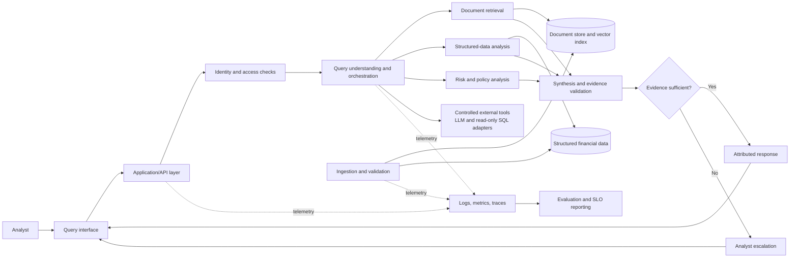

# Initial System Blueprint

> **Status:** Initial design proposal
> **Basis:** [`README.md`](../../README.md), [`Master Capstone Project Overview.md`](../../Master%20Capstone%20Project%20Overview.md), dataset specification, Sprint 1 approach/use-case/evaluation documents, [`SLO_Metric.md`](../SLO_Metric.md), and supplied finance policy/framework PDFs
> **Audience:** Project team, analysts, and reviewers

This blueprint translates the project brief and supporting project documents into a logical design for an educational Finance Risk & Investment Intelligence System. It is intentionally technology-neutral: the project has not selected a model provider, database, orchestration framework, or deployment platform. SLOs below are proposed acceptance targets, not measured results. This blueprint describes intended architecture, not evidence that an executable system or its controls already exist.

## 1. Business Goal and Use Cases

### Business goal

Help financial analysts find, compare, and explain relevant financial information faster by combining document retrieval, structured-data analysis, and specialized agent workflows. Responses should make their supporting sources and limitations visible, and uncertain or conflicting results should be escalated rather than presented as certain.

The system is an **analyst-assistance and educational decision-support tool**. It does not make or execute investment decisions and is not a source of personalized financial advice.

### Primary users

- **Financial analysts:** ask questions, review evidence, and prepare research.
- **Risk managers:** investigate exposures, risk indicators, and policy alignment.
- **Investment teams and decision makers:** consume concise, traceable summaries.
- **Project operators:** ingest datasets, monitor services, and resolve failures.

### Representative use cases

1. **Portfolio risk analysis:** identify risk factors affecting a portfolio, with evidence from portfolio metrics and relevant reports.
2. **Performance comparison (conditional):** compare portfolio or asset performance with a selected benchmark only when validated historical portfolio and benchmark return series are available. The current standardized dataset does not contain those series, so quantitative benchmark-relative performance, volatility, Value at Risk (VaR), and drawdown are unsupported until the data is extended and validated.
3. **Regulatory exposure assessment:** retrieve applicable regulatory or disclosure material and map it to supplied portfolio or sector exposure.
4. **Market trend evaluation:** summarize a trend from approved market data and supporting documents.
5. **Historical pattern analysis:** identify unusual risk or volatility patterns in available historical data and explain the comparison basis.
6. **Policy alignment check:** compare an investment or portfolio against supplied risk policies and flag gaps or ambiguity.

The supplied seven policy/framework PDFs and generated dataset are educational/synthetic materials. Identify the source title, version, and citation; do not present them as authoritative external law, live market facts, or investment advice.

## 2. System Scope and Boundaries

### In scope

- Analyst query intake and intent identification.
- Routing to document retrieval, structured-data analysis, and risk-analysis capabilities.
- Retrieval from approved, ingested documents with source metadata.
- Analysis of available structured portfolio, market-indicator, decision-history, and risk data; benchmark-return analysis is conditional on additional validated data.
- Multi-step orchestration for scenarios requiring multiple evidence types.
- Response synthesis with citations, assumptions, data timestamps, and uncertainty.
- Escalation of missing, ambiguous, conflicting, or low-confidence results.
- Basic operational monitoring, access control, and ingestion traceability.
- Evaluation against the versioned 50-case golden set, with separate RBAC and guardrail safety tests.

### Out of scope for the initial version

- Executing trades, rebalancing portfolios, or changing accounts.
- Producing guaranteed forecasts or autonomous investment recommendations.
- Treating generated output as regulated advice or a replacement for expert review.
- Accessing private institutional systems or live market feeds unless explicitly configured and authorized.
- Ingesting arbitrary external content at query time without source validation.
- Replacing a system of record for financial data, compliance decisions, or approvals.

### System boundaries

The system consumes user queries and approved knowledge/data sources. It returns an evidence-backed analysis for human review. External model services, data providers, identity systems, and storage services are dependencies whose availability, privacy terms, and authorization must be assessed before selection.

The initial structured-data boundary is the five standardized tables: `portfolios`, `portfolio_holdings`, `asset_risk_logs`, `market_indicators`, and `investment_decisions`. These synthetic records do not supply historical benchmark returns or consistently model issuer identifiers, geography, currency, liquidity, portfolio mandate, or policy effective dates. Analyses requiring unavailable fields must be reported as unknown/out of scope, not inferred. No external market or regulatory source is assumed available unless separately approved and ingested.

## 3. Logical Architecture and Data Flow

### Main components

| Component | Responsibility |
|---|---|
| Query interface | Accept a question and any permitted context; show answer, citations, limitations, and escalation status. |
| Application/API layer | Validate requests, enforce identity and authorization, coordinate application services, and shape responses. |
| Query understanding | Identify intent, entities, time ranges, portfolio/benchmark references, and missing parameters. |
| Manager/orchestrator | Own the stateful workflow; plan, delegate to specialists, validate handoffs, track completion, and enforce bounded workflow steps. |
| Document retrieval | Search approved indexed content and return relevant passages with source metadata. |
| Structured-data analysis | Use controlled, read-only, allowlisted SQL and deterministic calculations over validated data; return filters, units, timestamps, and provenance. |
| Risk and policy analysis | Apply documented indicators or policy criteria to evidence; distinguish computation from interpretation. |
| Synthesis and evidence validation | Reconcile agent outputs, verify citations and coverage, express uncertainty, and format the response. A bounded reflection/self-correction pass may identify missing evidence or schema errors; it must not override policy or repeat indefinitely. |
| Ingestion and validation | Parse, normalize, validate, index, version, and report document/data ingestion outcomes. |
| External tool adapters | Provide narrowly scoped interfaces to the selected model provider and read-only SQL/data services; enforce permissions, parameterization, timeouts, and output validation in application code. |
| Observability and evaluation | Capture service/workflow telemetry, run versioned quality and safety evaluations, and report SLO results without unnecessarily recording sensitive content. |
| Human escalation | Receive an authorized structured handoff with evidence, attempted steps, unresolved gaps, and requested review; ownership and destination must be assigned before operational use. |

### High-level data flow

1. Approved files and datasets enter through ingestion, where their source, owner, timestamps, access labels, and processing status are recorded.
2. Documents are parsed and chunked for retrieval; structured records are normalized and stored for analysis. Both retain provenance back to source material.
3. An authenticated analyst submits a question. The application validates authorization and query parameters.
4. Query understanding identifies the task and determines which capabilities and evidence sources are needed.
5. The orchestrator invokes only relevant retrieval and analysis tasks, then sends their outputs to synthesis.
6. Synthesis checks that conclusions are supported by returned evidence and decides whether to answer, qualify, ask for clarification, or escalate.
7. The interface displays the response with citations, relevant dates, assumptions, and limitations. Operational telemetry records workflow outcomes.

## 4. Agent Roles and Orchestration

Agents are logical roles, not necessarily separate deployed services or autonomous systems. The initial implementation may realize them as constrained components or tool calls under one orchestrator.

| Role | Input | Responsibility and output |
|---|---|---|
| Query understanding | User question and authorized context | Classifies the task, extracts entities and requested period, and identifies missing parameters for clarification. |
| Manager/orchestrator | Classified request, authorization scope, and specialist results | Creates the bounded plan, delegates to relevant specialists, tracks workflow state, validates handoffs, and decides whether to complete, clarify, or escalate. |
| Financial document retrieval | Query plan and authorized corpus scope | Retrieves relevant passages and returns source IDs, titles, dates, locations, and relevance information. |
| Market/portfolio data analyst | Query plan and authorized structured data | Computes requested comparisons or metrics with units, filters, period, benchmark, and data timestamps. |
| Risk analysis | Evidence and applicable risk definitions | Evaluates supported risk indicators and explains the basis; flags unavailable inputs and policy ambiguity. |
| Synthesis/validation | Agent outputs and evidence references | Produces a coherent, appropriately qualified answer; checks evidence linkage and identifies contradictions or gaps. |
| Human analyst | Escalation packet | Resolves questions requiring judgment, conflicting evidence, unavailable data, or policy interpretation. |

### Orchestration principles

- Prefer deterministic routing and explicit tools for calculations; use language models for interpretation and synthesis, not as the source of numeric facts.
- Use a stateful, bounded Plan–Reason–Act workflow: the manager creates an evidence plan, delegates independent work where useful, validates structured results, and stops when completion or escalation criteria are met.
- Apply a single bounded reflection/self-correction step to correct missing fields, unsupported claims, or invalid tool output; preserve the original failure and escalate if validation still fails. Reflection must not weaken authorization, safety rules, or escalation decisions.
- Provide each role only the context it needs and authorize data access before retrieval or analysis.
- Define allowed inputs, outputs, timeouts, and completion conditions for each role.
- Keep workflows bounded: limit steps, retries, retrieved context, and execution time.
- Preserve the provenance of each intermediate result so final claims can be traced to evidence.
- Do not allow agents to make external side-effecting changes such as trades or portfolio updates.

## 5. Knowledge Architecture and Ingestion (RAG)

### Knowledge sources

The initial approved document corpus is the seven supplied educational/synthetic PDFs:

- `01_Investment_Strategy_Portfolio_Allocation_Guide.pdf`
- `02_Risk_Management_Exposure_Policy.pdf`
- `03_Regulatory_Compliance_Financial_Governance_Policy.pdf`
- `04_Market_Analysis_Investment_Research_Guide.pdf`
- `05_Portfolio_Monitoring_Performance_Evaluation_Guide.pdf`
- `06_Basel_III_Risk_Management_Summary.pdf`
- `07_Investment_Risk_Assessment_Framework.pdf`

The structured source is the standardized synthetic five-table dataset listed in System Boundaries. The dataset does not include benchmark return history; other sources or fields may be added only after approval, licensing/privacy review, validation, and provenance capture. Do not imply that arbitrary external filings, live feeds, or private portfolio data are present.

### Ingestion stages

1. **Register source:** capture source name, owner, source type, publication/effective date, ingestion timestamp, version, access classification, and permitted use.
2. **Validate input:** check format, size, required fields, encoding, and basic integrity; quarantine invalid or unsupported inputs with an actionable error.
3. **Parse and normalize:** extract document text and tables while preserving page/section references; validate structured schemas, units, identifiers, and date formats.
4. **Prepare content:** chunk documents by meaningful sections, attach metadata to every chunk, and avoid losing document-level context.
5. **Index and store:** store canonical source content and structured data in appropriate stores; create vector representations for approved document chunks. Keep source IDs and version information in the index.
6. **Quality-check:** verify record counts, parse coverage, required metadata, and sample retrieval results before making a batch available.
7. **Publish or reject:** make validated batches queryable; surface ingestion failures and allow controlled reprocessing or removal.

### Retrieval and evidence requirements

- Apply user authorization and source filters before results are provided to an analysis workflow.
- Combine semantic search with metadata filters and, where useful, keyword search.
- Return stable source identifiers and precise locations (for example, document title and page/section).
- Include publication/effective date and ingestion/version metadata to support freshness checks.
- Prefer evidence that directly supports the requested claim; expose conflicting or stale sources rather than silently selecting one.
- Treat retrieved document text as untrusted input. It may inform an answer but must not override system instructions or authorize actions.
- Retain lineage from generated chunks and calculations to original documents or dataset records.

The selected embedding model, vector database, chunking strategy, retention policy, and refresh schedule are not specified by the project brief and should be decided during implementation.

## 6. Query Processing Flow

1. **Receive and authenticate:** accept the query, identify the user/session, and confirm access to the requested portfolio, datasets, and documents.
2. **Validate and clarify:** detect missing or ambiguous portfolio identifiers, dates, currency, benchmark, or metric definitions. Ask a focused follow-up rather than silently guessing when the ambiguity affects the result.
3. **Classify and plan:** identify intents such as policy/RAG, structured/SQL, hybrid, high-risk, or mandatory escalation; produce a bounded plan and required evidence. Reject or qualify requests requiring unsupported inputs, including benchmark return history.
4. **Retrieve and calculate:** fetch authorized document evidence and run explicit structured-data calculations with stated filters, units, and periods.
5. **Analyze and cross-check:** compare evidence across sources, validate date alignment and metric definitions, and identify unsupported claims or disagreement.
6. **Assess sufficiency and reflect once if useful:** determine whether evidence is complete, current, and consistent enough for a useful response. A bounded correction may address a fixable retrieval/format gap; if evidence remains insufficient or a mandatory escalation trigger is present, do not answer autonomously.
7. **Synthesize:** present a concise answer, key findings, calculation basis, citations, data as-of dates, assumptions, and limitations.
8. **Return and record outcome:** render the response and record operational status and suitable audit metadata in accordance with retention and privacy policy.

## 7. State, Memory and Response Management

### State model

- **Request-scoped state:** query, extracted parameters, authorized scope, workflow plan, tool results, citations, and completion status. Keep it bounded and discard it after the request unless retention is explicitly required.
- **Session state / short-term memory:** short-lived conversational context, such as a clarified date range or portfolio identifier, scoped to the authenticated user and authorized portfolio. Make it visible, allow reset, expire it by policy, and never let it broaden access or silently carry context across users.
- **Workflow state:** current plan, specialist assignments, validated handoffs, retry/reflection count, and terminal outcome for each request. Persist only the minimum needed to support asynchronous status, audit, or human handoff, subject to retention policy.
- **Persistent knowledge:** approved documents, structured datasets, and their provenance. This is a governed knowledge store, not conversational memory.
- **Audit metadata:** user/request identifiers, access decision, source versions, workflow status, and escalation outcome, retained according to an approved policy. Avoid storing full prompts or sensitive outputs by default.

Do not treat prior model-generated answers as authoritative facts. Any reusable result should be stored as a versioned, attributable data product and revalidated for freshness.

### Response contract

Responses should include, as applicable:

- Direct answer and key findings.
- Analysis period, portfolio/asset scope, benchmark, units, and metric definitions.
- Citations linked to source documents or dataset provenance.
- Relevant as-of/publication dates.
- Material assumptions, data gaps, and conflicting evidence.
- A clear confidence or sufficiency statement using a defined project convention.
- An explicit educational/non-advisory limitation where appropriate.
- Escalation status and the question or decision needing human review.

## 8. Failure and Escalation Paths

| Condition | Expected handling |
|---|---|
| Missing or ambiguous query parameters | Ask for clarification before calculations whose results depend on those parameters. |
| No relevant documents or data | State what was unavailable; do not fabricate evidence; offer a narrower query or escalate. |
| Stale or incomplete source data | Qualify the result with data dates and gaps; escalate if freshness is material to the requested decision. |
| Conflicting sources or calculations | Show the disagreement and source dates/definitions; do not force a single conclusion; route for analyst review when unresolved. |
| Parse, validation, or indexing failure | Mark the affected source unavailable, report the ingestion error, and prevent it from being treated as successfully indexed. |
| Retrieval, database, or model service timeout | Apply bounded retries where safe; report partial/unavailable analysis and preserve a request status for support. |
| Agent/tool error or invalid output | Validate output against the expected schema; stop dependent steps and return a clear limitation or escalation, not a success-shaped fallback. |
| Low evidence sufficiency or unsupported conclusion | Withhold or qualify the conclusion and create an escalation packet with query, evidence, gaps, and attempted steps. |
| Explicit escalation flag, material policy breach, approval/override request, or mandatory high-risk case | Enforce the application-level guardrail and hand off to the designated human-review queue; synthesis cannot downgrade the classification. |
| Authorization failure | Deny access without disclosing whether unauthorized resources exist; record an appropriate security event. |

Escalation should include the original question, user-authorized context, attempted workflow, source references, calculations and their parameters, unresolved uncertainty, and the specific human action requested. Escalations should not expose information the analyst is not authorized to view.

## 9. Security, Observability and Deployment

### Security and governance

- Authenticate users and enforce least-privilege authorization at the API, retrieval, and data-access layers.
- Separate data by access classification and prevent cross-portfolio or cross-user retrieval.
- Use approved transport and storage protections; manage credentials through the deployment platform's secret-management mechanism.
- Minimize sensitive data in prompts, logs, traces, and model-provider requests. Review provider retention and training policies before sending data externally.
- Validate and constrain file ingestion; treat documents, retrieved text, and user-supplied content as untrusted.
- Use allowlisted data sources and tools; prohibit autonomous trade execution and other unapproved side effects.
- Establish retention, deletion, access-review, and incident-response policies before production use.
- Keep a traceable record of data versions and system/model configuration relevant to analytical outputs.
- Ensure financial interpretations and high-impact conclusions receive appropriate human review.

### Observability

Capture service and workflow health, including:

- Request counts, latency, error rates, and dependency availability.
- Query intent and workflow completion status at an appropriately aggregated level.
- Retrieval hit/empty rates, source freshness, ingestion errors, and validation outcomes.
- Agent/tool timeouts, retries, schema failures, and escalation rates.
- Citation coverage and evidence-sufficiency outcomes, measured without assuming that a fluent response is correct.

Use correlation IDs to connect a request's stages. Redact or avoid sensitive query and portfolio details in telemetry; restrict log access and define retention. Track measured SLOs and their test/data versions as described below; thresholds are not to be deferred to later implementation.

### Evaluation and SLO enforcement

The following are proposed acceptance targets from `Documents/SLO_Metric.md`. The achieved-value column is blank; **none of these targets is claimed as achieved**. Measure on a versioned evaluation run, report numerator/denominator and sample size where applicable, and include dataset/corpus versions and test conditions. The 50-case golden set is split as follows: 15 policy/RAG, 10 portfolio/SQL, 10 hybrid risk, 10 high-risk financial decision, and 5 escalation cases. Supplement it with dedicated RBAC-isolation and guardrail-bypass tests.

| Measure | Proposed target |
|---|---:|
| Faithfulness | >=80% |
| Answer relevance | >=75% |
| Context precision | >=70% |
| End-to-end latency | <=2 seconds; report workload and p50/p95 |
| Answer accuracy | >=85% |
| Retrieval recall | >=75% |
| LLM-as-a-judge confidence | >=80%; fixed rubric and judge version, not a substitute for human-labeled accuracy |
| Task success rate | >=90%; expected safe escalation counts as success |
| SQL correctness | >=95% exact match to golden ground truth |
| Source attribution rate | 100% of material claims verifiably supported |
| Critical-risk misclassification rate | <3% |
| Mandatory escalation recall | 100%; any missed required handoff fails acceptance |
| Unauthorized data access | 0 violations |
| Guardrail effectiveness | 100% on defined attack/control-bypass cases |
| Query routing accuracy | >=95% |
| Risk classification accuracy | >=95% |

Set and approve a numeric per-request and/or per-evaluation-run **cost ceiling before acceptance evaluation**; record actual cost alongside latency and quality. The project approach also proposes measuring analyst-time reduction against a documented manual baseline, with a 30% median reduction as a proposed goal pending stakeholder agreement. No quality, attribution, or safety target may be traded away to meet cost or latency goals. Any mandatory-escalation miss, RBAC violation, or unsafe guardrail pass is a hard acceptance failure regardless of aggregate scores.

### Deployment approach

The initial system can be deployed as a small application/API with separate logical services for ingestion, orchestration, retrieval, structured-data access, and observability. These may share a deployment unit for a prototype, provided interfaces and access boundaries remain clear.

Recommended environments are development, test/evaluation, and deployment/demo (or production if formally approved), with separate credentials and datasets. Use repeatable configuration, versioned ingestion/indexing artifacts, health checks, and a documented rollback/re-index procedure. The specific hosting platform, network topology, scaling approach, and model-provider configuration remain undecided.

## 10. Assumptions, Risks and Open Items

### Assumptions

- The first release is an educational prototype supporting analyst review, not an autonomous financial service.
- Initial data is the supplied synthetic dataset and educational policy/framework corpus; any additional public data requires approval and provenance.
- Documents and structured records will be available for the seven defined use cases, except analyses dependent on fields/data not present in the current schema.
- Users can identify the portfolio, date range, and benchmark needed for a meaningful analysis, or the system can request clarification. A benchmark identifier alone does not provide missing historical benchmark returns.
- Source attribution and human escalation are required behaviors, not optional enhancements.
- No live trading, account modification, or unreviewed external action is permitted.

### Risks and mitigations

| Risk | Initial mitigation |
|---|---|
| Incorrect or incomplete financial data leads to misleading conclusions | Validate schemas, dates, units, and coverage; report data as-of dates and gaps; test calculations with known cases. |
| Fluent generated text is unsupported by evidence | Require claim-level source references where feasible, validate citation targets, and qualify or withhold unsupported conclusions. |
| Sources conflict or use different definitions | Preserve source dates/definitions, expose disagreement, and escalate unresolved material conflicts. |
| Stale indexes or datasets | Track versions and freshness; define refresh ownership and alerts; disclose stale data. |
| Prompt injection or malicious content in documents | Treat retrieved content as data, isolate it from instructions, constrain tools, and test ingestion/retrieval defenses. |
| Unauthorized disclosure across users or portfolios | Enforce authorization before retrieval and at data access; test isolation boundaries. |
| Model/provider outage, cost, or changing behavior | Bound usage and retries; monitor dependency health and cost; maintain evaluation tests and a clear degraded-mode response. |
| Users interpret output as investment advice | Label the system's educational/decision-support role and require human review for consequential use. |

### Open items

1. Select the runtime, dependency manifest, model/provider, orchestration framework, database, vector index, deployment platform, and configure a safe environment contract.
2. Create and validate executable canonical DDL and a deterministic, reproducible synthetic-data generation/load process; record dataset and schema versions.
3. Define identity and portfolio access mapping. Until tenant/customer isolation is implemented and tested, restrict operation to an explicitly scoped single-user/single-tenant prototype; do not claim multi-tenant RBAC compliance.
4. Assign the human-review owner, queue/destination, reviewer permissions, disposition workflow, and handoff service expectations before enabling operational escalation.
5. Build and version the 50-case golden set, exact SQL oracles, retrieval relevance annotations, safety cases, and automated evaluation runner.
6. Define risk-label mappings, policy precedence/effective-date handling, and authoritative metric conventions. Preserve source-specific labels and escalate unresolved ambiguity.
7. Decide whether to extend the data model with benchmark return history, issuer/geography, currency, liquidity, mandate, and policy effective dates; until then, dependent analyses remain unknown/out of scope.
8. Set the numeric cost ceiling and approve the analyst-time baseline/target; confirm retention, deletion, audit, and confidence/sufficiency conventions.
9. Complete the setup-readiness gates and verify environment reproducibility before claiming implementation readiness or SLO compliance.

## Design Decisions to Validate

Before implementation is treated as production-ready, resolve the setup blockers above, execute the 50-case evaluation and dedicated RBAC/guardrail tests against the stated SLOs, demonstrate all seven use cases (including an expected non-answer/escalation), and review data handling and human-escalation behavior with the intended users. Report measured results and unsupported analyses explicitly; this proposal itself does not establish implementation readiness or production compliance.
