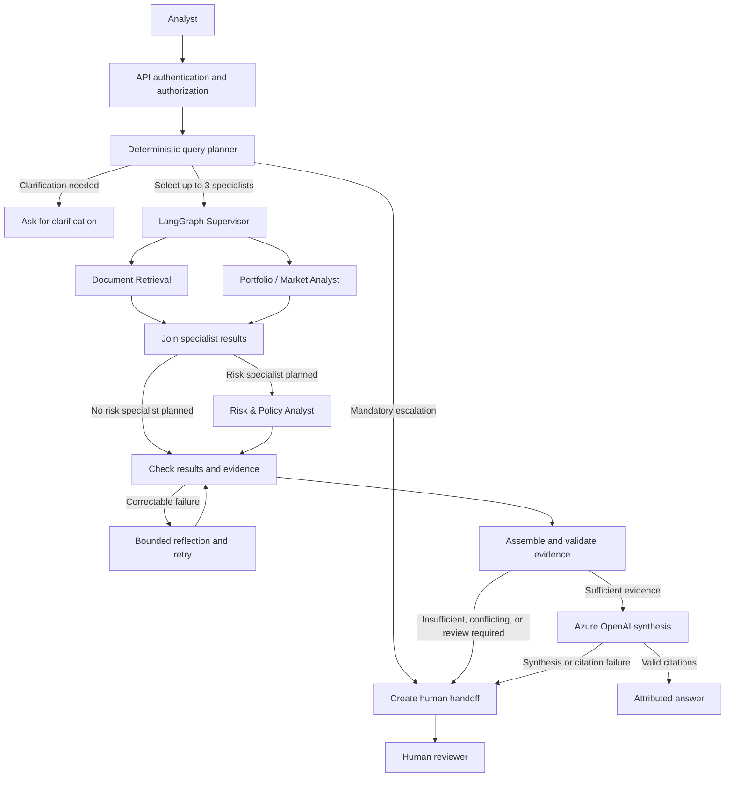

# FRIIS Multi-Agent Workflow

The diagram shows the implemented LangGraph query workflow. The planner is deterministic; the supervisor delegates only the specialists needed for a query. The optional tool-enabled Finance agent is a separate endpoint and is not part of this graph.

